# ENTITY RELATIONSHIP DIAGRAM (ERD)
## SiGudang – 036 | Database: uts_25K10036

> **Pengembang:** Leonard Sihol Pardede  
> **NIM:** 25K10036  
> **Database:** `uts_25K10036`  
> **Prefix Seluruh Tabel:** `t036_`  
> **Tahun:** 2026  

---

## 1. Diagram ERD (Mermaid Format)

```mermaid
erDiagram
    t036_roles ||--o{ t036_users : "memiliki (1:N)"
    t036_users ||--o{ t036_mutasi_stok : "mencatat (1:N)"
    t036_users ||--o{ t036_audit_logs : "melakukan (1:N)"
    t036_supplier ||--o{ t036_barang : "memasok (1:N)"
    t036_barang ||--o{ t036_mutasi_stok : "mengalami (1:N)"
    t036_users ||--o{ t036_personal_access_tokens : "tokenable (1:N)"

    t036_roles {
        bigint id PK "Auto Increment"
        string name UK "Nama Role: Manajer, Staf Gudang, Auditor"
        text description "Deskripsi kewenangan"
        timestamp created_at
        timestamp updated_at
    }

    t036_users {
        bigint id PK "Auto Increment"
        bigint role_id FK "Relasi ke t036_roles.id"
        string username UK "NIM atau ID Pengguna unik"
        string name "Nama lengkap pengguna"
        string email UK "Alamat email unik"
        string password "Hash bcrypt"
        string profile_photo "Path foto profil di uploads/profil/"
        boolean is_active "Status aktif/nonaktif akun"
        string remember_token "Token remember me"
        timestamp created_at
        timestamp updated_at
    }

    t036_supplier {
        bigint id PK "Auto Increment"
        string kode_supplier UK "Kode unik supplier (SUP-001)"
        string nama_supplier "Nama perusahaan pemasok"
        string nama_kontak "Nama PIC personil"
        string no_telepon "Nomor kontak WhatsApp/telepon"
        string email "Alamat email resmi"
        text alamat "Alamat fisik pabrik/gudang"
        string status "Status kerjasama: Aktif/Nonaktif"
        timestamp created_at
        timestamp updated_at
    }

    t036_barang {
        bigint id PK "Auto Increment"
        string kode_barang UK "Kode unik barang (BRG-001)"
        string nama_barang "Nama item inventaris"
        string kategori "Kategori produk"
        string satuan "Satuan fisik (Unit, Pcs, Box, Roll)"
        int stok "Saldo kuantitas fisik terkini"
        int stok_minimum "Ambang batas peringatan stok"
        string lokasi_penyimpanan "Lokasi rak atau zona docking"
        bigint supplier_id FK "Relasi ke t036_supplier.id"
        text deskripsi "Spesifikasi teknis barang"
        timestamp created_at
        timestamp updated_at
    }

    t036_mutasi_stok {
        bigint id PK "Auto Increment"
        bigint barang_id FK "Relasi ke t036_barang.id"
        bigint user_id FK "Relasi ke t036_users.id (Petugas)"
        enum tipe_mutasi "Tipe: masuk / keluar"
        int jumlah "Kuantitas perubahan stok"
        int stok_sebelum "Saldo kuantitas sebelum mutasi"
        int stok_sesudah "Saldo kuantitas setelah mutasi"
        text keterangan "Surat jalan, PO, atau nomor ref"
        datetime tanggal_mutasi "Waktu pergerakan fisik barang"
        timestamp created_at
        timestamp updated_at
    }

    t036_audit_logs {
        bigint id PK "Auto Increment"
        bigint user_id FK "Relasi ke t036_users.id (Nullable)"
        string action "LOGIN, LOGOUT, TAMBAH, UBAH, HAPUS, MUTASI"
        string module "AUTENTIKASI, BARANG, SUPPLIER, MUTASI, PENGGUNA, PROFIL"
        text description "Uraian rinci aktivitas sistem"
        timestamp created_at "Waktu pencatatan log"
    }

    t036_personal_access_tokens {
        bigint id PK "Auto Increment"
        string tokenable_type "Model App\\Models\\User"
        bigint tokenable_id "ID Pengguna pemilik token"
        string name "Nama token API"
        string token UK "Hash SHA-256 Bearer Token"
        text abilities "Kemampuan token"
        timestamp last_used_at "Waktu terakhir digunakan"
        timestamp expires_at "Waktu kadaluarsa"
        timestamp created_at
        timestamp updated_at
    }

    t036_password_reset_tokens {
        string email PK "Alamat email"
        string token "Token reset"
        timestamp created_at
    }
```

---

## 2. Rincian Relasi & Integritas Referensial Antartabel

### 1. `t036_roles` ke `t036_users` (One-to-Many / 1:N)
- **Primary Key:** `t036_roles.id`
- **Foreign Key:** `t036_users.role_id`
- **Aturan Integritas:** `ON DELETE RESTRICT` (Mencegah penghapusan role apabila masih memiliki akun pengguna terkait).
- **Penjelasan:** Setiap pengguna wajib memiliki satu tingkat hak akses (Manajer, Staf Gudang, atau Auditor). Satu role dapat diemban oleh banyak pengguna.

### 2. `t036_supplier` ke `t036_barang` (One-to-Many / 1:N)
- **Primary Key:** `t036_supplier.id`
- **Foreign Key:** `t036_barang.supplier_id`
- **Aturan Integritas:** `ON DELETE RESTRICT`
- **Penjelasan:** Setiap item barang diasosiasikan dengan satu mitra pemasok resmi. Satu supplier dapat memasok banyak jenis barang inventaris. Supplier tidak dapat dihapus sebelum seluruh barang terkait dialihkan.

### 3. `t036_barang` ke `t036_mutasi_stok` (One-to-Many / 1:N)
- **Primary Key:** `t036_barang.id`
- **Foreign Key:** `t036_mutasi_stok.barang_id`
- **Aturan Integritas:** `ON DELETE RESTRICT`
- **Penjelasan:** Setiap mutasi stok dicatat untuk satu item barang spesifik. Satu barang dapat memiliki riwayat transaksi masuk dan keluar yang panjang. Barang yang telah memiliki riwayat transaksi dilarang dihapus untuk menjaga keabsahan pembukuan.

### 4. `t036_users` ke `t036_mutasi_stok` (One-to-Many / 1:N)
- **Primary Key:** `t036_users.id`
- **Foreign Key:** `t036_mutasi_stok.user_id`
- **Aturan Integritas:** `ON DELETE RESTRICT`
- **Penjelasan:** Mencatat siapa petugas operator (Manajer atau Staf Gudang) yang bertanggung jawab atas eksekusi pergerakan barang fisik tersebut.

### 5. `t036_users` ke `t036_audit_logs` (One-to-Many / 1:N)
- **Primary Key:** `t036_users.id`
- **Foreign Key:** `t036_audit_logs.user_id`
- **Aturan Integritas:** `ON DELETE SET NULL`
- **Penjelasan:** Setiap tindakan krusial pengguna (login, logout, modifikasi, hapus) dicatat dalam audit log. Jika pengguna dinonaktifkan atau dihapus, riwayat audit log tetap terjaga dengan `user_id` menjadi `NULL`.

### 6. `t036_users` ke `t036_personal_access_tokens` (Polymorphic One-to-Many / 1:N)
- **Foreign Key:** `tokenable_type` dan `tokenable_id`
- **Aturan Integritas:** `ON DELETE CASCADE`
- **Penjelasan:** Mendukung sistem otorisasi REST API Laravel Sanctum. Setiap pengguna dapat memiliki beberapa bearer token aktif yang dapat dicabut kapan saja saat logout.

---

## 3. Indeks & Optimalisasi Kinerja Database

1. **Unique Indexes:**
   - `t036_roles.name` (Mencegah duplikasi nama role)
   - `t036_users.username` & `t036_users.email` (Memastikan kredensial login unik)
   - `t036_supplier.kode_supplier` (Mencegah duplikasi kode supplier)
   - `t036_barang.kode_barang` (Memastikan integritas kode inventaris barang)
   - `t036_personal_access_tokens.token` (Pencarian token cepat dan unik)
2. **Foreign Key Indexes:**
   - Otomatis dibuat oleh MySQL InnoDB untuk seluruh kolom `_id` guna mempercepat operasi `JOIN`, verifikasi integritas referensial, dan pencarian relasional.
3. **Compound Morph Index:**
   - `[tokenable_type, tokenable_id]` pada `t036_personal_access_tokens` untuk pencarian token pengguna dalam hitungan milidetik.

---
**© 2026 Leonard Sihol Pardede – 25.K1.0036**
